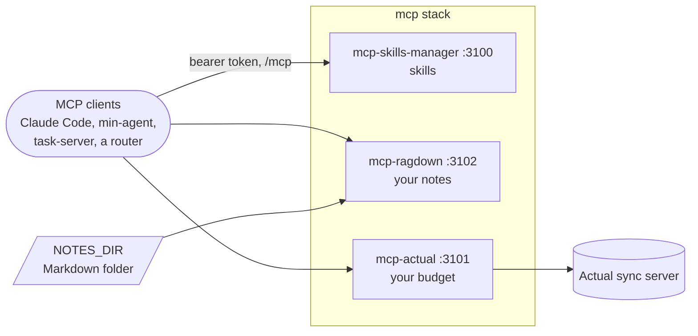

An MCP server is a set of tools any Model Context Protocol client can call —
Claude Code, Claude Desktop, [min-agent](/projects/min-agent/),
[task-server](/projects/task-server/). The ones here are built to run on a
server you own, over streamable HTTP, so you set each up once and every client
on your network can use it.

Every one of them follows the same shape: a Docker container, a bearer token,
an endpoint at `/mcp`, and a web UI for anything that would otherwise be a
config file.

## The stack

One compose file runs all three. Paste it into a new stack, or
[download it](/templates/mcp/docker-compose.yml). Don't use Actual Budget? Delete the
`mcp-actual` service.

Set these in the stack's environment; generate tokens with
`openssl rand -hex 32`. A server whose token is left empty generates one and prints it to its logs.

| variable | |
| --- | --- |
| `SKILLS_TOKEN`, `RAGDOWN_TOKEN`, `ACTUAL_MCP_TOKEN` | the bearer token each client sends |
| `NOTES_DIR` | the Markdown folder mcp-ragdown indexes |
| `ACTUAL_SERVER_URL`, `ACTUAL_PASSWORD`, `ACTUAL_SYNC_ID` | your Actual sync server and budget, for mcp-actual |

| server | port | endpoint |
| --- | --- | --- |
| [mcp-skills-manager](/projects/mcp-skills-manager/) | 3100 | `/mcp` |
| [mcp-actual](/projects/mcp-actual/) | 3101 | `/mcp` |
| [mcp-ragdown](/projects/mcp-ragdown/) | 3102 | `/mcp/<folder>` |

The three servers are independent of each other. Each one checks its own
token, and none of them needs a database.



<details class="compose">
<summary><code>mcp.yml</code> — show the compose file</summary>

```yaml

```

</details>

## 1. Skills: mcp-skills-manager

Start here. [mcp-skills-manager](/projects/mcp-skills-manager/) serves skills —
Markdown playbooks for how you want a kind of work done — to every agent, and
gives you a web editor for them at `http://<host>:3100`. Write a skill once and
every client has it.

```sh
claude mcp add --transport http skills http://<host>:3100/mcp \
  --header "Authorization: Bearer $SKILLS_TOKEN"
```

## 2. Your notes: mcp-ragdown

[mcp-ragdown](/projects/mcp-ragdown/) indexes the Markdown in `NOTES_DIR` and
gives agents hybrid search over it. Each top-level folder becomes its own MCP
server, off until you turn it on under **Settings → Folders**:

```sh
claude mcp add --transport http ragdown-work http://<host>:3102/mcp/work \
  --header "Authorization: Bearer $RAGDOWN_TOKEN"
```

Add a before-turn hook that calls `ragdown_context` and related notes land in
the prompt without the agent having to ask.

## 3. Your budget: mcp-actual (optional)

If you run [Actual Budget](https://actualbudget.org),
[mcp-actual](/projects/mcp-actual/) opens one budget file and serves it. Set
`ACTUAL_ENABLE_WRITES=false` and the tools that change the budget are not
offered at all.

## Then: one endpoint instead of three

Three servers is three entries in every client's config, three tokens, and the
same edit made three times when one moves. Put them behind
[mcp-router](/projects/mcp-router/) and each client gets one URL with exactly
the tools it should have — [Run your own AI infrastructure](/guides/ai-infrastructure/)
starts there. mcp-router can also discover mcp-skills-manager on the LAN, if
you turn on its "Advertise on the local network" setting (which needs
`network_mode: host` in Docker). Both sides of that are
[mcp-discovery](/projects/mcp-discovery/), if you want your own servers found
the same way.

The personal-cloud apps serve MCP endpoints too; see
[Start a personal cloud](/guides/personal-cloud/).
