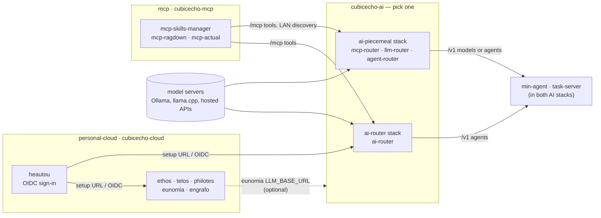
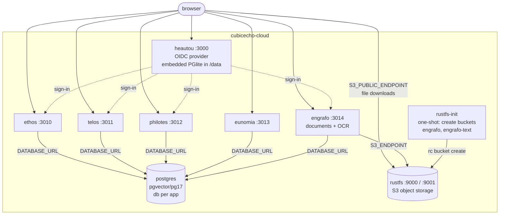
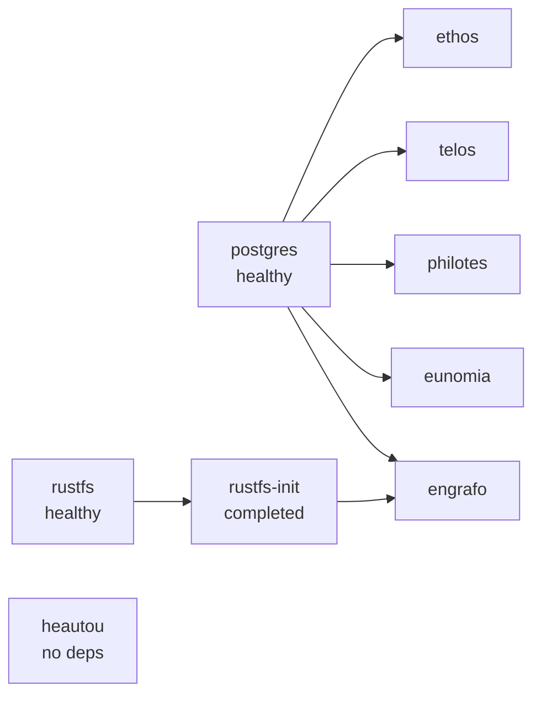
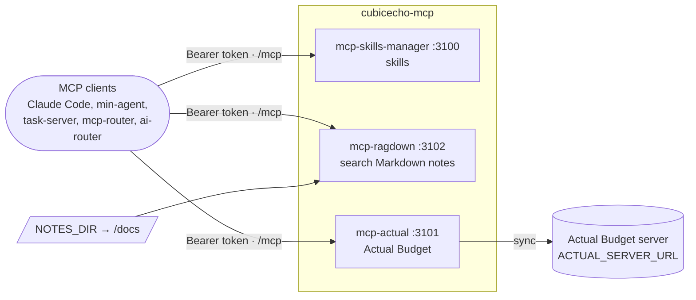
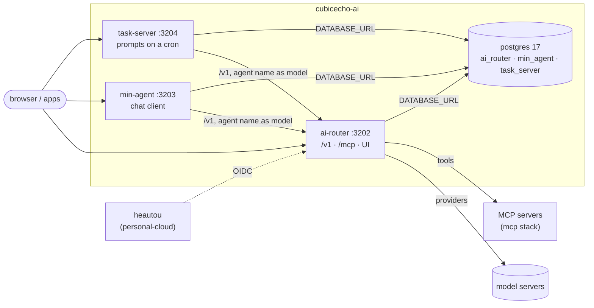
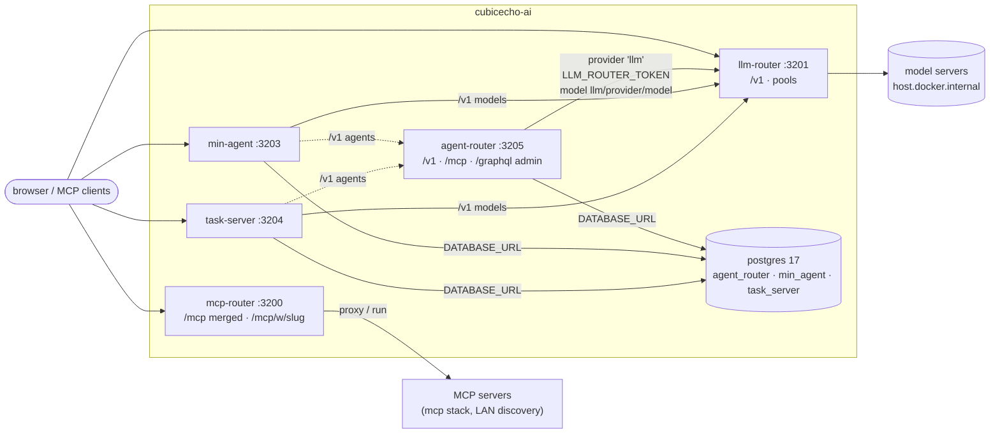

# Stack templates

Each folder holds one `docker-compose.yml`, served from the site at
`/templates/<slug>/docker-compose.yml` and shown inline by the matching guide
(``).

| stack | compose project | guide |
| --- | --- | --- |
| [`personal-cloud`](./personal-cloud/docker-compose.yml) | `cubicecho-cloud` | [personal-cloud](../src/guides/personal-cloud.md) |
| [`mcp`](./mcp/docker-compose.yml) | `cubicecho-mcp` | [mcp](../src/guides/mcp.md) |
| [`ai-router`](./ai-router/docker-compose.yml) | `cubicecho-ai` | [ai-infrastructure](../src/guides/ai-infrastructure.md) |
| [`ai-piecemeal`](./ai-piecemeal/docker-compose.yml) | `cubicecho-ai` | [ai-infrastructure](../src/guides/ai-infrastructure.md) |

## How the stacks fit together

The four stacks share no Docker network. Each one reaches the others through
`PUBLIC_HOST` and a published port, and you set up most of those links in an
app's UI, not in compose. `ai-router` and `ai-piecemeal` use the same compose
project name (`cubicecho-ai`), so run **one or the other**.

## personal-cloud

Self-hosted apps behind one sign-in. Every app except heautou keeps its data
in its own database on one pgvector Postgres. engrafo also stores files in
RustFS (S3-compatible), and a one-shot job creates its buckets.

The order containers start in, from `depends_on`:

The first time the `postgres-data` volume is created, the `create-databases`
config runs `CREATE DATABASE` for ethos, telos, philotes, eunomia and engrafo.
Point an app's `*_DATABASE_URL` at your own Postgres to skip the bundled one.

## mcp

Three MCP servers that don't depend on each other. Each one has a bearer
token, a `/mcp` endpoint and a web UI. None of them needs a database.

## ai-router (all in one)

ai-router covers models, MCP tools and agents in one app with one UI. It
signs people in through heautou or any OIDC issuer.

## ai-piecemeal

The same jobs as ai-router, split into three services: mcp-router for tools,
llm-router for models and agent-router for agents. agent-router has no UI and
no published image yet. It runs a checkout from `AGENT_ROUTER_SRC` on
`node:26-slim`, and its only provider is llm-router, under the name `llm`.

`LLM_ROUTER_TOKEN` has to be set by you, not generated, because llm-router
checks it and agent-router sends it. mcp-router and llm-router keep their state
in `/data` volumes, not in Postgres.

## Ports at a glance

| stack | default host ports |
| --- | --- |
| personal-cloud | heautou 3000 · ethos 3010 · telos 3011 · philotes 3012 · eunomia 3013 · engrafo 3014 · rustfs 9000 (S3) / 9001 (console) |
| mcp | skills 3100 · actual 3101 · ragdown 3102 |
| ai | mcp-router 3200 · llm-router 3201 · ai-router 3202 · min-agent 3203 · task-server 3204 · agent-router 3205 |

Each port can be changed with that service's `*_PORT` variable.
